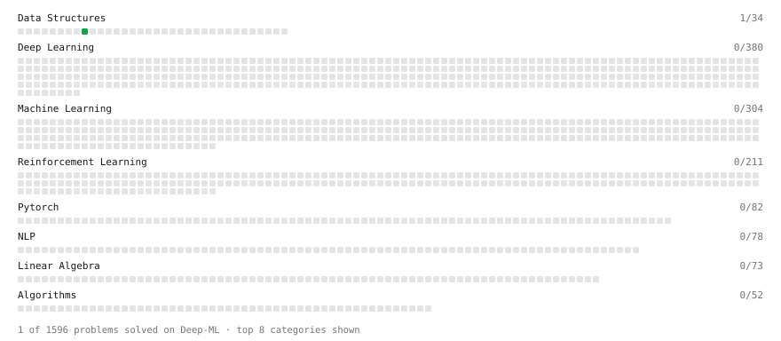

# Deep-ML

My machine learning practice from [Deep-ML](https://www.deep-ml.com). Every solution here was written by hand.

**1** solved · 1 problems · 0 labs · 0 math

[**Browse the interactive portfolio**](https://Tanvi1505.github.io/deep-ml/) to replay this filling in over time.

## Problems

| | Difficulty | Solved | |
| --- | --- | --- | --- |
| [Add Two Numbers as Linked Lists](https://www.deep-ml.com/problems/1086) | easy | 2026-10-18 | [solution](problems/1086-add-two-numbers-as-linked-lists) |

---

_This file is regenerated by Deep-ML on every push._
